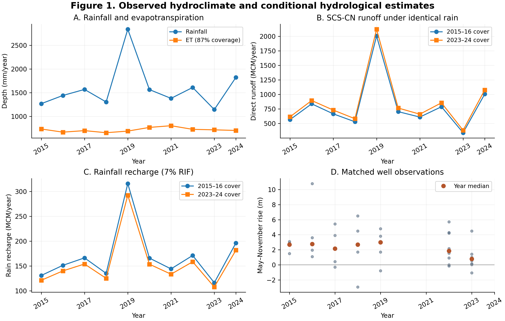
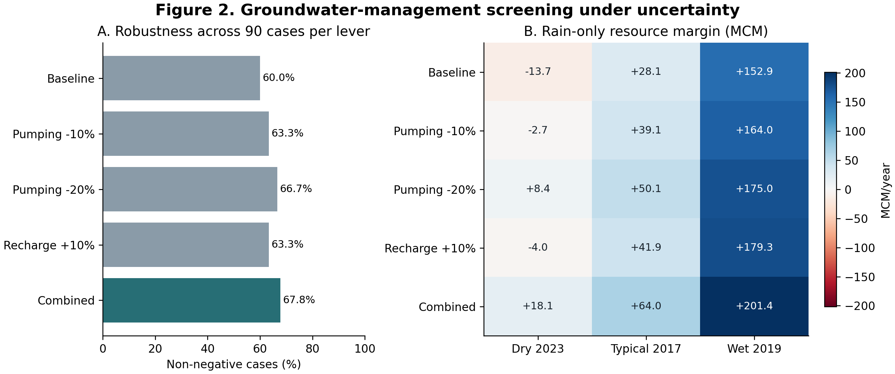
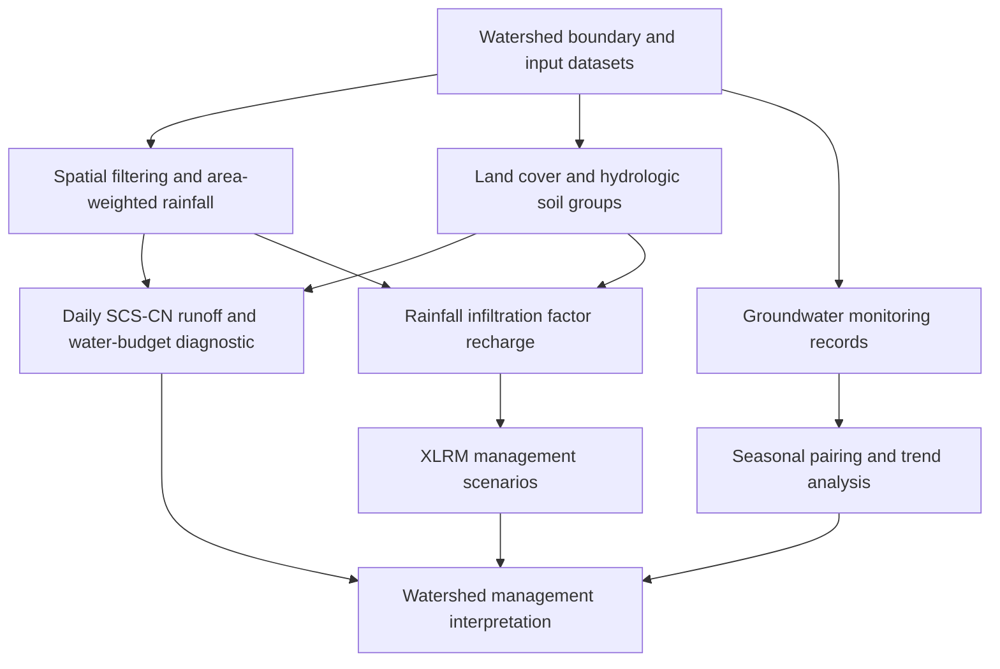

# Mula–Mutha Watershed Management

**Groundwater sustainability under changing land use and rainfall variability**  
CE766 · Watershed Management · Pune, Maharashtra, India · 2015–2024

[Project overview](#project-overview) · [Key findings](#key-findings) · [Results](#results) · [Methodology](#methodology) · [Data and code](#repository-guide) · [Reproduce the analysis](#reproduce-the-analysis)

| Study area | Study period | Rainfall records | Management simulations |
| :---: | :---: | :---: | :---: |
| **2,038 km²** | **2015–2024** | **3,653 days** | **450 runs** |

## Project overview

The Mula–Mutha catchment upstream of Pune is experiencing land-cover change alongside highly variable monsoon rainfall and groundwater use. This project combines satellite-derived land cover, daily rainfall, soil groups, evapotranspiration and monitoring-well records to assess hydrological changes and screen groundwater management alternatives under uncertainty.

The final analysis extends the preliminary land-cover comparison with site-specific rainfall–runoff modelling, recharge estimates, a water-budget diagnostic and quantitative management scenarios. It is a screening study, not a calibrated groundwater simulation.

## Key findings

| Indicator | Result | Interpretation |
|---|---:|---|
| Built area | 336.7 → 499.6 km² | +48.4% relative growth |
| Mean annual rainfall | 1,594 mm | Strong interannual variability |
| Modelled direct runoff | 803.75 → 866.92 MCM/year | +7.86% under identical rainfall |
| Modelled rainfall recharge (7% RIF) | 169.27 → 156.69 MCM/year | −7.43% under stated assumptions |
| Median seasonal water-table rise | 1.83 m | 34 of 40 matched observations show recovery |
| Best tested management robustness | 67.8% | Combined pumping reduction and recharge enhancement |

MCM = million cubic metres. The runoff and recharge comparisons are conditional estimates for two land-cover configurations, not observed historical changes in water fluxes. No eligible well-season series showed a significant long-term trend at the 5% level.

## Results

### Figure 1 — Historical hydrology and land-cover impacts



Rainfall, estimated evapotranspiration, direct runoff, rainfall recharge and matched groundwater observations. Both land-cover configurations are evaluated with the same rainfall sequences to isolate the modelled land-cover effect.

[Annual hydrology table](results/annual_results.csv) · [Daily runoff calculations](results/daily_rainfall_runoff.csv) · [Seasonal well pairs](results/seasonal_pairs.csv)

### Figure 2 — Groundwater management under uncertainty



The combined intervention achieves a non-negative rain-recharge resource margin in 67.8% of tested cases, versus 60.0% for baseline and 66.7% for a 20% pumping reduction alone. These case frequencies are not probabilities of success.

[Scenario summary](results/scenario_summary.csv) · [All scenario calculations](results/scenarios.csv) · [Recharge estimates](results/recharge.csv)

## Methodology



### XLRM framework

| Component | Implementation |
|---|---|
| X — Uncertainties | Ten historical rainfall sequences; RIF 2%, 7%, 13%; three regional abstraction intensity proxies |
| L — Levers | Baseline; 10% or 20% pumping reduction; 10% recharge enhancement; combined intervention |
| R — Relationships | SCS Curve Number runoff; GEC-style rainfall recharge; rain-only resource margin; water-budget diagnostic |
| M — Measures | Annual runoff and recharge; seasonal well rise; trend tests; fraction of cases with non-negative resource margin |

The five alternatives were assessed against 90 uncertainty combinations each. Curve Number sensitivity was evaluated separately. See the [methodology and audit notes](docs/Methodology_and_Audit.txt) for equations, parameter assumptions and limitations.

## Repository guide

| Folder / file | Contents |
|---|---|
| [data/](data/) | Input datasets, catchment boundary, archived groundwater extract and source documentation |
| [scripts/analysis.py](scripts/analysis.py) | Main reproducible Python model |
| [scripts/earth_engine/](scripts/earth_engine/) | Land-cover, soil, combined soil/land-cover and ET extraction scripts |
| [scripts/lulc_change_analysis.py](scripts/lulc_change_analysis.py) | Original supplementary land-cover analysis |
| [results/](results/) | Calculated annual and daily hydrology, groundwater trends, recharge and scenarios |
| [figures/](figures/) | Two final submission visuals |
| [docs/](docs/) | Submission answers, methodology notes and calculation log |
| [requirements.txt](requirements.txt) | Python dependencies |

**Data provenance:** [sources, original files and access notes](data/SOURCES.md).

**Submission:** [final written answers](docs/Final_Submission_Answers.txt).

## Reproduce the analysis

From the repository root, using Python 3:

```bash
python -m pip install -r requirements.txt
python scripts/analysis.py
```

The script reads `data/`, writes tables to `results/` and saves both figures in `figures/`. It uses the included filtered pre-monsoon observations when the original national PDF is absent. The optional original PDF (with Poppler installed) and CWC discharge CSV can be supplied to repeat the respective source-extraction and station-coverage checks. See [data sources](data/SOURCES.md). The main numerical outputs were reproduced from this reorganized package and compared with the original project results.

## Limitations and management implications

- Groundwater abstraction is represented by regional benchmark scenarios rather than measured catchment extraction.
- No verified outlet discharge record is used. The diagnostic residual is neither observed storage change nor groundwater recharge.
- ET is extrapolated from 87.3% coverage. Aquifer distribution, land-cover classification, reservoir operations and monitoring gaps introduce uncertainty.
- Combined management performs best on the selected hydrological metric, but the small additional improvement over pumping reduction alone warrants cost, feasibility and equity assessment.

The analysis supports preliminary prioritization of pumping efficiency, recharge-area protection and site-specific recharge pilots, not exact infrastructure capacities or extraction limits.

## References

1. Wagner, P. D., Kumar, S., & Schneider, K. (2013). Land-use change impacts on water resources of the Mula and Mutha Rivers catchment. *Hydrology and Earth System Sciences*, 17, 2233–2246. [DOI](https://doi.org/10.5194/hess-17-2233-2013).
2. USDA Soil Conservation Service (1986). *Urban Hydrology for Small Watersheds*, TR-55. [Curve Number tables](https://www.hec.usace.army.mil/confluence/hmsdocs/hmstrm/cn-tables).
3. GSDA & CGWB (2025). *Report on Dynamic Ground Water Resources of Maharashtra, 2024*. [Official report listing](https://gsda.maharashtra.gov.in/en-groundwater-resource-estimation/).

For dataset citations, see [data/SOURCES.md](data/SOURCES.md). This repository is prepared for academic review; third-party data remain subject to their respective terms.
